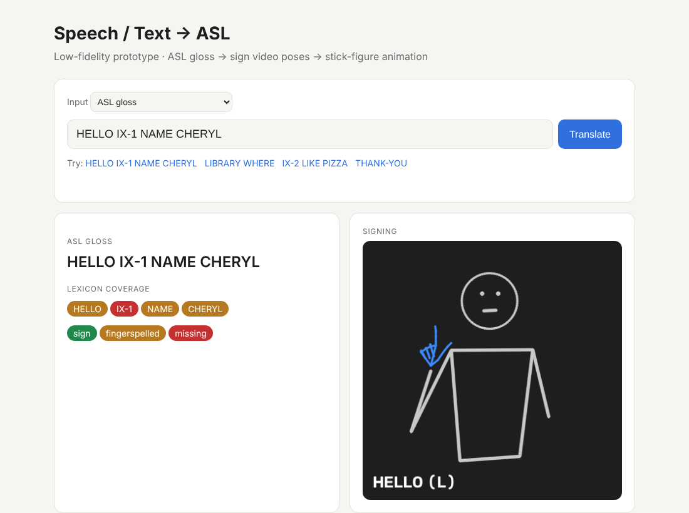

# S2A: ASL Gloss → Sign → Stick Figure (low-fidelity prototype)

Type an **ASL gloss** sentence like `TOMORROW IX-1 WANT GO SCHOOL`. The program finds a **real ASL sign** for each word, keeps only the **body and hand movement** (no faces), and shows a **stick figure** signing the whole sentence.

This is **Team 2's** part of the Speech → ASL pipeline:

```
Team 1:  🎤 Speech → 📝 Text → 🗣️ T5 Transformer → ASL gloss  (e.g. TOMORROW IX-1 WANT GO SCHOOL)
                                                         │
Team 2:                                                  ▼
         📖 sign dictionary → 🦴 body + hand dots → 🔗 join signs → 🕺 stick figure
```



- [Part 1: Run the demo (step by step, no experience needed)](#part-1-run-the-demo)
- [Part 2: Build the sign dictionary](#part-2-build-the-sign-dictionary)
- [Part 3: How it works](#part-3-how-it-works)
- [Part 4: Data sources](#part-4-data-sources)
- [Part 5: For developers](#part-5-for-developers)
- [Current limitations](#current-limitations) · [Next steps for Team 2](#next-steps-for-team-2)

---

# Part 1: Run the demo

These steps are for a **Mac**. Windows users should see the [Windows notes](#windows-notes).

> ⚠️ **Paste ONE command at a time.** Press **Enter**, and wait until you see the `%` prompt again before pasting the next one. If you paste several lines together, Terminal can treat them as answers to the previous command and things break.

## First time only (about 10–15 minutes)

### Step 1: Check you have Python
Open **Terminal**: press **⌘ Command + Space**, type `Terminal`, then press **Enter**. Paste:
```bash
python3 --version
```
- If it shows **Python 3.10 or higher**, you're good (3.11 or 3.12 is safest).
- If it shows 3.9 or `command not found`, install Python 3.12 from https://www.python.org/downloads/, then close and reopen Terminal.
- If a popup asks to install "command line developer tools", click **Install**.

### Step 2: Download the project
1. Open https://github.com/Cherlz/Speech-to-ASL. You don't need a GitHub account.
2. Click the green **`<> Code`** button → **Download ZIP**.
3. Open **Downloads** in Finder and **double-click** `Speech-to-ASL-main.zip`. A folder called `Speech-to-ASL-main` appears.

> **Already use git?** You can clone instead of downloading the ZIP. The folder is then called `Speech-to-ASL`, so use `cd ~/Downloads/Speech-to-ASL` in Step 3:
> ```bash
> cd ~/Downloads
> git clone https://github.com/Cherlz/Speech-to-ASL.git
> ```
> To get the latest changes later, run `git pull` inside the folder.

### Step 3: Go into the project folder
```bash
cd ~/Downloads/Speech-to-ASL-main
```

### Step 4: Create the project's private Python space (a "virtual environment")
```bash
python3 -m venv .venv
```
This makes a hidden `.venv` folder that keeps the project's tools separate from the rest of your Mac.

### Step 5: Activate it (step inside the space)
```bash
source .venv/bin/activate
```
✅ Your Terminal line should now start with **`(.venv)`**. If it doesn't, don't continue. Go back to Step 3.

### Step 6: Install everything (3–8 minutes)
```bash
pip install -e .
```
✅ Wait until the last lines say **`Successfully installed ...`**.

### Step 7: Start the demo
```bash
s2a demo
```
✅ Terminal says `S2A demo running at http://localhost:8000` and your browser opens the demo page.

## Using the demo
- The **Input** dropdown is set to **ASL gloss**. Type gloss words in CAPITALS, separated by spaces, and press **Translate** (or **Enter**).
- Click one of the **"Try:"** examples.
- The colored chips show how each word was handled:
  - 🟢 **sign:** a real sign from the dictionary
  - 🟠 **fingerspelled:** spelled letter by letter, because there's no sign for it yet
  - 🔴 **missing:** skipped (for example a pointing sign like `IX-1` with no clip yet)
- Until you [build the sign dictionary](#part-2-build-the-sign-dictionary), every word shows 🟠, because only the A–Z alphabet is included.
- Switch **Input** to **English** to try the whole pipeline. A stand-in text → gloss model turns your sentence into gloss first, and the 🎤 **Speak** button appears.

> **Keep Terminal open while you use the demo.** Terminal is the "engine". If you close it, the page stops working.

## Stopping and exiting
1. **Stop the demo:** click on the Terminal window and press **Control + C**. Use the `control` key, not ⌘. It prints `stopped`.
2. **Leave the virtual environment** (optional):
   ```bash
   deactivate
   ```
   The `(.venv)` disappears from the start of the line.
3. **Quit Terminal:** **⌘ Command + Q**. If it asks *"terminate running processes?"*, click **Terminate**. That only means the demo was still running.

Nothing is lost. Everything stays in the `Speech-to-ASL-main` folder.

## Every time after that (3 commands)
Open Terminal and paste one at a time:
```bash
cd ~/Downloads/Speech-to-ASL-main
```
```bash
source .venv/bin/activate
```
```bash
s2a demo
```

---

# Part 2: Build the sign dictionary

The **sign dictionary** links each gloss word to the movement of a real ASL sign. Building it is the main job of Team 2. For each word, the builder:

1. 🔎 finds the word in **WLASL**, a research collection of 2,000 ASL words and 21,000 sign videos
2. ⬇️ downloads a video of a real person signing it
3. 👀 uses **MediaPipe** to find the body and finger positions ("dots") in every frame
4. ✅ checks the person and hands were clearly visible, and tries another video if not
5. 💾 saves **only the dots** into `data/lexicon/`
6. 🗑️ **deletes the video**, so no faces or identities are kept

Do this with `(.venv)` active (Steps 3 and 5 above), and stop the demo first if it's running.

### Add specific words
```bash
s2a lexicon-wlasl --glosses tomorrow me want go school hello name my you
```
Each word takes a few seconds. You'll see lines like:
```
[3/9] WANT: saved
[4/9] GO: skipped one video (HTTPError: HTTP Error 404: Not Found)
[4/9] GO: saved
```
Some videos are no longer online. "Skipped one video" is normal: the builder just tries the next one.

### Or add the 100 most common words (about 10–20 minutes)
```bash
s2a lexicon-wlasl --top 100
```

### Check what's in the dictionary
```bash
s2a lexicon-list
```

### Try it
```bash
s2a demo
```
Type `TOMORROW IX-1 WANT GO SCHOOL`. The words should now be 🟢 **signs**. `IX-1` ("me") uses the **ME** sign.

You can also save a GIF instead of using the demo:
```bash
s2a gloss-to-video --gloss "TOMORROW IX-1 WANT GO SCHOOL" --video tomorrow.gif
```
```bash
open tomorrow.gif
```

### Notes
- The first run downloads MediaPipe's model file (about 13 MB) once.
- Running the same command again **skips words that are already in the dictionary**, so it's safe to stop (**Control + C**) and start again.
- Words that aren't in WLASL are listed as "Not in WLASL (skipped)". Those will still be fingerspelled.
- WLASL videos on YouTube are downloaded with `yt-dlp`, which installs automatically in Step 6.

### Using your own videos
If your team records signs (with the signer's permission), name each file after its gloss and put them in one folder:
```
my_signs/HELLO.mp4
my_signs/NAME.mp4
my_signs/THANK-YOU.mp4
my_signs/HELLO__take2.mp4      ← extra takes: add __ and anything after the gloss
```
Then run:
```bash
s2a lexicon-folder --videos my_signs
```
Your original videos are **not** deleted. Only the dots are copied into the dictionary.

## Troubleshooting

| What you see | What it means and what to do |
|---|---|
| `Username for 'https://github.com'` | The repo link is mistyped, so GitHub thinks it's a private repo. Press **Control + C** and check the link, or use the ZIP download (Step 2). |
| `command not found: s2a` or `command not found: python` | The virtual environment isn't active, or the install didn't finish. Run Step 5, check for `(.venv)`, then Step 6. |
| `no such file or directory: .venv/bin/activate` | Step 4 didn't run, or you're in the wrong folder. Run Step 3, then Step 4. |
| `does not appear to be a Python project` | You're in the wrong folder. Run Step 3 first. |
| `No matching distribution found for mediapipe` | Your Python version is too new or too old. Install Python 3.12 (Step 1), delete the `.venv` folder (`rm -rf .venv`), then redo Steps 4–6. |
| `NO usable video found` for a word | None of the tried videos for that word could be downloaded or read. Try `s2a lexicon-wlasl --glosses WORD` again later, or record your own video. |
| `Address already in use` | The demo is already running in another Terminal window. Use that one, or run `s2a demo --port 8001`. |
| Browser didn't open | Open Chrome and go to **http://localhost:8000** yourself. |
| `[notice] A new release of pip is available` | Harmless. Ignore it. |

## Windows notes
Use **Command Prompt** instead of Terminal, with the same steps except:
- Step 1: `py --version`
- Step 3: `cd %USERPROFILE%\Downloads\Speech-to-ASL-main`
- Step 4: `py -m venv .venv`
- Step 5: `.venv\Scripts\activate`
- Stop the demo with **Ctrl + C**.

---

# Part 3: How it works

## Building the dictionary (done once, ahead of time)
```
"SCHOOL"
   │ 📋 look up "school" in WLASL's list (humans already labelled every video with its word)
   ▼
 video link → ⬇️ download
   │ 🎞️ OpenCV splits the video into frames
   ▼
 frame 1, frame 2, frame 3 ...
   │ 👀 MediaPipe finds 75 dots in each frame (33 body + 21 per hand)
   ▼
 💾 save the dots as signs/SCHOOL.npz   🗑️ delete the video
```

## Gloss → stick figure (every time you press Translate)
```
"TOMORROW IX-1 WANT GO SCHOOL"
   │ ✂️ 1. split into words
   ▼
[TOMORROW] [IX-1] [WANT] [GO] [SCHOOL]
   │ 🔎 2. look up each word: real sign 🟢 → else fingerspell A–Z 🟠 → else skip 🔴
   ▼
 dots for each sign (each from a different person and camera)
   │ 📏 3. same size & position: shoulders centred and the same width for every sign
   │ ✂️ 4. trim the "hands resting" parts at the start and end of each clip
   │ ⏩ 5. speed up slow dictionary signs (max ~1 s per sign, ~0.35 s per letter)
   │ 🔗 6. add a short 0.2 s slide between signs so the hands don't teleport
   ▼
 🎨 7. draw lines between the dots, frame by frame → 🕺 one stick figure signing the sentence
```

**Key words**
- **Gloss:** ASL written as CAPITAL English words in ASL order. `IX-1` means pointing at yourself ("me"), and `IX-2` means "you".
- **Pose / dots:** where the body and finger joints are in one video frame, 75 points per frame.
- **MediaPipe:** a free Google tool (a machine-learning model) that finds those dots in pictures. We use it ready-made.
- **Sign dictionary (lexicon):** the saved dots for each gloss word, in `data/lexicon/`, plus the A–Z alphabet in `assets/fingerspelling/`.

**Privacy:** MediaPipe can also give 468 detailed face points. We throw those away and keep only the body and hand points, plus a few rough head points (nose, eyes, ears) so the head's position is known. Videos are deleted after the dots are extracted, and the stick figure's head is a plain circle. So no one's face or identity is kept, and every sign can later be put onto one standard avatar.

| Step | Code | Ours or reused |
|---|---|---|
| Find and download sign videos | `s2a/gloss_to_pose/build.py` | Ours (WLASL index; `yt-dlp` for YouTube) |
| Video → dots | `s2a/gloss_to_pose/extract.py` | Google MediaPipe |
| Gloss → dictionary lookup | `s2a/gloss_to_pose/lexicon.py` | Ours |
| Same size, trim, speed up, join | `s2a/gloss_to_pose/concatenate.py` | Ours |
| Dots → stick figure | `s2a/pose_to_video.py` | Ours |
| Demo page | `s2a/demo.py` | Ours (Python server + HTML/CSS/JavaScript) |
| *(stand-in for Team 1)* English → gloss | `s2a/text_to_gloss/` | A small Transformer trained from scratch, until Team 1's model is connected |

The design follows [sign-language-processing/spoken-to-signed-translation](https://github.com/sign-language-processing/spoken-to-signed-translation).

---

# Part 4: Data sources
1. **WLASL** (Li et al., 2020): 2,000 ASL glosses and about 21,000 sign videos, [dxli94/WLASL](https://github.com/dxli94/WLASL). Licensed under the **Computational Use of Data Agreement (C-UDA)**, for research and computational use. The builder downloads the index file (`data/WLASL_v0.3.json`) and the videos on your computer. Neither the videos nor the extracted dictionary are stored in this repo.
2. **Fingerspelling A–Z poses:** from [sign.mt](https://sign.mt), via the MIT-licensed spoken-to-signed-translation project. They were converted to our format in `assets/fingerspelling/`, and the license is in that folder.
3. **ASLG-PC12** (Othman & Jemni, 2012), only for the stand-in text → gloss model. About 87,000 English/gloss pairs, downloaded by `scripts/prepare_aslg.py` and not stored in this repo.

---

# Part 5: For developers

## Command reference
```bash
# Team 2: gloss → sign → stick figure
s2a gloss-to-video --gloss "..." --video out.gif [--pose out.npz] [--lexicon DIR ...] [--no-fingerspell]
s2a lexicon-wlasl  [--glosses w1 w2 ... | --glosses-file words.txt | --top 100] [--per-gloss 1] [--lexicon DIR]
s2a lexicon-folder --videos DIR [--labels labels.csv] [--per-gloss 1] [--lexicon DIR]
s2a lexicon-add    --gloss WORD (--video sign.mp4 | --pose-file sign.pose) [--source "..."] [--lexicon DIR]
s2a lexicon-list   [--lexicon DIR ...]
s2a demo           [--port 8000] [--lexicon DIR ...]

# Full pipeline with the stand-in text → gloss model
s2a text-to-gloss  --text "..." [--glosser model|rules] [--beam 5]
s2a text-to-video  --text "..." --video out.gif
s2a speech-to-video --audio clip.wav --video out.gif      # needs: pip install -e ".[speech]" and ffmpeg
```

## The sign dictionary format
A lexicon is a folder with an `index.csv` (`path,gloss,kind,source`) and one `.npz` file per clip:
- `data`: `(frames, 75, 3)` keypoints, x/y/z. The order is 33 MediaPipe body points, then 21 left-hand points, then 21 right-hand points.
- `confidence`: `(frames, 75)`. 0 means the point wasn't detected.
- `fps`: frames per second.

The A2S team can load the same files for recognition.

`lexicon-folder --labels` takes a CSV with `file,gloss` columns, plus optional `frame_start`, `frame_end` (1-based, inclusive) and `source`.

How gloss is matched to clips (`s2a/gloss_to_pose/lexicon.py`):
- Multi-word glosses use hyphens, so `THANK YOU` becomes `THANK-YOU`.
- Pointing, possessive and reflexive glosses use the English pronoun's sign until dedicated clips exist: `IX-1` → `ME`, `IX-2` → `YOU`, `POSS-1` → `MY`, and so on. They're never fingerspelled.
- ASLG-style markers from the stand-in model are normalized: `X-I` → `IX-1`, `X-MY` → `POSS-1`, `DESC-FAR` → `FAR`, `X-IVY` → `IVY`.

## The stand-in text → gloss model
A 7.6M-parameter Transformer encoder-decoder, trained from scratch on ASLG-PC12. On the test set it gets BLEU 94.3, and 81% of sentences exactly right, against BLEU 22.8 for a rule baseline. That only measures agreement with ASLG-PC12's rule-generated gloss, not real ASL quality. Team 1 owns this step. To retrain:
```bash
pip install -e ".[dev]"
python scripts/prepare_aslg.py
python -m s2a.text_to_gloss.train --data data/aslg --out models/text2gloss --epochs 5 --warmup 800
python -m s2a.text_to_gloss.evaluate --data data/aslg --split test --model models/text2gloss
```

## Tests
```bash
pip install -e ".[dev]"
pytest -q
```
The tests cover:
- pose maths
- dictionary lookup, pronoun fallbacks and fingerspelling
- the WLASL and folder builders, with MediaPipe and downloads replaced by stubs
- the stand-in model
- the command line

## Project layout
```
s2a/
  gloss_to_pose/
    build.py             WLASL / folder → sign dictionary
    extract.py           video → dots (MediaPipe)
    lexicon.py           gloss → clip lookup
    concatenate.py       normalize, trim, speed up, join signs
    pose.py              the 75-point pose format
  pose_to_video.py       stick-figure renderer
  demo.py                browser demo
  cli.py                 the `s2a` command
  text_to_gloss/         stand-in text → gloss model (Team 1's step)
  speech_to_text.py      Whisper wrapper (Team 1's step)
assets/fingerspelling/   A–Z poses
data/lexicon/            your built sign dictionary (created by the builders, not in git)
models/text2gloss/       stand-in model
tests/
```

---

# Current limitations
1. **Dictionary signs are not fluent signing.** Each word is a separate, slowly signed dictionary clip. Real ASL uses space, facial grammar, role shift and classifiers, and signs blend into each other.
2. **No facial expressions.** ASL grammar uses the face (for questions, negation, etc.), and the stick figure only has the body and hands.
3. **Different signers.** Each sign may come from a different person. Normalizing size and position helps, but body shapes and signing styles still differ.
4. **Pointing signs** (`IX-1`, `IX-2`…) use the English pronoun's dictionary sign for now.
5. **Some WLASL links are dead**, and a few words may get a lower-quality clip. Watch the results and replace bad ones with your own recordings.
6. **The joins between signs are straight-line slides**, not real human transitions.

# Next steps for Team 2
- **Word list:** agree with Team 1 on the gloss format and the words to cover first, then build them.
- **Quality check:** watch each sign and replace jumpy or wrong ones.
- **Pointing signs:** record clips for `IX-1`, `IX-2` and `IX-3`.
- **Face:** add a few face points back for expressions, without identity.
- **Avatar:** map the dots onto one standard 3D or 2D avatar.
- **ASL experts:** ask fluent signers to review the output.
